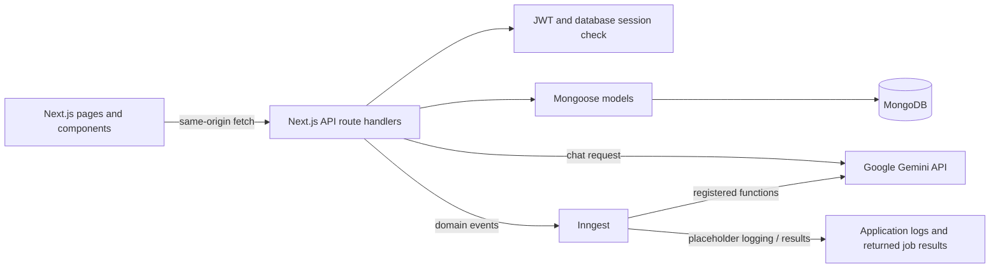

# SerenAI Architecture

**Audit basis:** repository source and configuration present on 2026-11-12. `npm run build` succeeds, but no service-backed end-to-end tests were found. "Verified" below means verified in source and/or by local build, not verified in a deployed environment.

## Project Overview

SerenAI is implemented as one Next.js App Router application. React client pages call same-origin Next.js route handlers. Those handlers use Mongoose with MongoDB, authenticate through signed JWTs plus database-backed session records, call Google Gemini for chat responses, and send selected domain events to Inngest.

There is no `backend/` directory or `backend/package.json` in the workspace. `logs/legacy-backend/` contains logs, not an active backend service. No separate frontend/backend deployment or public API host was verified.

## Technology Stack

| Concern | Verified implementation |
| --- | --- |
| Web framework and routing | Next.js App Router; package manifest declares Next 15.5.9, but installed `node_modules` contains 15.5.4 (see risks) |
| UI | React 19, TypeScript, Tailwind CSS 4, local components using Radix UI, lucide-react, Framer Motion |
| Database / ODM | MongoDB via Mongoose 8.19.1 |
| Authentication | bcryptjs password hashes, jsonwebtoken JWTs, HTTP-only `serenai_session` cookie, MongoDB `Session` records |
| Generative AI | `@google/genai`, model `gemini-2.0-flash` |
| Background jobs | Inngest 4.26.2; route at `/api/inngest` |
| Markdown / dates | react-markdown, date-fns |
| Test tooling | No test script or test/spec files found |

## High-Level Architecture



This describes source wiring only. External MongoDB, Gemini, and Inngest credentials/services were not exercised as an integrated runtime.

## Frontend Structure

- `app/`: App Router pages (`/`, `/login`, `/signup`, `/dashboard`, `/therapy/[sessionId]`) and API route handlers under `app/api/`.
- `components/`: shared header/footer/providers, auth, mood and activity forms, relaxation games, and local UI primitives.
- `lib/api/`: browser-side fetch clients for auth, chat, mood, and activity.
- `lib/contexts/session-context.tsx`: client-side session state, populated from `/api/auth/me`.
- `public/`: default Next.js images and sound assets.

`components/header.tsx` links to `/features` and `/about`, and the login page links to `/forgot-password`; no matching page routes exist in the audited tree/build output. The dashboard renders an activity/game area and mood/activity modals. Its AI check-in drawer is empty.

## Backend Structure

The backend is not a separate service. Server-side work lives in Next.js route handlers in `app/api/`, with shared server utilities in `lib/` and schemas in `models/`. `lib/auth.ts`, `lib/db.ts`, and `lib/chat-ai.ts` are marked `server-only`. There is no separate backend router, controller layer, or authentication middleware file; protected handlers call `getAuthenticatedUser()` directly.

## Database Models and Relationships

All schemas use Mongoose timestamps. References below are `ObjectId` references and are not declared as database-enforced foreign keys.

| Model | Fields / purpose | Relationship and indexes |
| --- | --- | --- |
| `User` | name, unique email, password hash | Root account record; timestamps |
| `Session` | userId, token, expiresAt, optional deviceInfo, lastActive | `userId` references User; unique token; TTL index on expiresAt |
| `ChatSession` | unique sessionId, userId, startTime, status, embedded messages | `userId` references User; messages embed role/content/timestamp/optional metadata |
| `Mood` | userId, score (0-100), optional note/context/activities, timestamp | `userId` references User; compound `{ userId, timestamp }` index |
| `Activity` | userId, type, name, optional description/duration/difficulty/feedback, timestamp | `userId` references User; user and `{ userId, timestamp }` indexes |

No retention/deletion workflow or user-data export endpoint was found.

## API Endpoints

All endpoints are served by the Next.js application. User-data endpoints require a valid session except registration and login. The Inngest endpoint is exposed through the Inngest SDK handler; its deployment-level request verification/configuration was not independently tested.

| Method and path | Verified behavior |
| --- | --- |
| `POST /api/auth/register` | Validates required strings, normalizes email, hashes password, creates User; no login cookie is issued |
| `POST /api/auth/login` | Checks email/password, signs a 24-hour JWT, stores token and session expiry, sets HTTP-only cookie |
| `POST /api/auth/logout` | Deletes matching Session record when present and clears cookie |
| `GET /api/auth/me` | Returns current authenticated user or 401 |
| `GET /api/auth/session` | Re-exports the `/me` GET handler |
| `POST /api/chat/sessions` | Creates an active chat session for the authenticated user |
| `GET /api/chat/sessions` | Lists that user's sessions, newest updated first |
| `GET /api/chat/sessions/[sessionId]` | Fetches an owned session |
| `GET /api/chat/sessions/[sessionId]/history` | Returns messages for an owned session |
| `POST /api/chat/sessions/[sessionId]/messages` | Validates nonempty message, sends Inngest event, calls Gemini synchronously, appends user and assistant messages, persists and returns response/analysis |
| `POST /api/mood` | Creates a 0-100 mood record and sends `mood/updated` event |
| `GET /api/mood` | Returns owned user's history, optionally date-filtered and limited to 500 |
| `GET /api/mood/stats` | Computes average/count/highest/lowest for week, month, or year (unrecognized periods fall back to week) |
| `POST /api/activity` | Creates an activity and sends `activity/completed` event; route currently accepts six types listed in its validator |
| `GET /api/activity` | Lists activities, optionally limited to current UTC day; response is capped at 500 |
| `GET`, `POST`, `PUT /api/inngest` | Inngest's `serve()` handler exposes the configured function endpoint |

Input validation is inconsistent. Registration and activity validate selected fields; mood validates only score range; chat validates only nonempty message. Malformed JSON and downstream errors generally reach a 500 response.

## Authentication and Authorization Flow

```mermaid
sequenceDiagram
  participant UI as Login page
  participant API as /api/auth/login
  participant DB as MongoDB
  participant C as Browser cookie
  participant P as Protected API
  UI->>API: POST email and password
  API->>DB: Find user; compare bcrypt hash
  API->>DB: Store JWT session and 24-hour expiry
  API-->>C: Set HTTP-only, SameSite=Lax cookie
  P->>P: Read cookie or Bearer token; verify JWT
  P->>DB: Match token, userId, and unexpired session
  P-->>UI: Continue as user, or return 401
```

Client session context checks `/api/auth/me`; it is UI state, not route protection. No Next middleware or page-level authorization guard was found. API ownership checks are present for chat resources; mood and activity queries are scoped to the current user.

## AI Integration and Conversation Flow

The browser calls the chat API through `lib/api/chat.ts`. The route checks ownership, emits `therapy/session.message`, then calls `generateChatReply()` directly. That helper makes two Gemini calls: one asks for analysis JSON, then one generates a reply using the message, analysis, and up to 12 prior messages. The route stores both messages and metadata in the MongoDB `ChatSession`.

The Inngest `processChatMessage` function also listens to `therapy/session.message` and calls Gemini for its own analysis and response. Its result is not consumed by the route or persisted. In the current route, the Inngest event is sent before the synchronous Gemini calls, so an event-send failure prevents the direct reply path. The background function is therefore not the response-delivery path.

`analyzeTherapySession` listens for `therapy/session.created`, but no producer for that event was found. It only returns/logs its analysis; the "store-analysis" step does not write to MongoDB. AI output is parsed as JSON without schema validation. A risk score is recorded from model output, but there is no verified crisis escalation, human support, or validated risk-handling workflow.

## Inngest Background Processing

`/api/inngest` registers functions in `lib/inngest/functions.ts` and `lib/inngest/aiFunctions.ts`.

- `therapy/session.message`: emitted by the chat message route; AI function runs separate analysis and response but has no user-visible/persistent result.
- `therapy/session.created`: two handlers are registered (a placeholder session handler and AI analysis); no event producer was found.
- `mood/updated`: emitted after mood creation; placeholder handler returns a fixed trend/recommendation, and AI recommendation function receives context fields not populated by the mood route. Results are not stored.
- `activity/completed`: emitted after activity creation; placeholder handler returns fixed progress/achievement values. It does not update a progress record.

These handlers are connected to Inngest's event registry, but the expected product side effects are not implemented. Because database writes occur before event sends, a send failure can return an error after the record has already been saved.

## Frontend-to-Backend Communication

Browser code calls relative `/api/...` URLs with same-origin credentials. Auth/chat/mood/activity helpers live in `lib/api/`; the dashboard also directly fetches activity endpoints, and mood form directly posts to `/api/mood`. No external API origin or client-side secret is configured. No `NEXT_PUBLIC_*` environment references were found.

## Environment Variables

Names and purposes only; values intentionally omitted. `.env.local` is ignored by Git and was not read.

| Variable | Purpose |
| --- | --- |
| `MONGODB_URI` | MongoDB connection string used by `lib/db.ts` |
| `JWT_SECRET` | Secret used to sign and verify auth JWTs |
| `GEMINI_API_KEY` | Server-side Google Gemini credential |
| `INNGEST_EVENT_KEY` | Inngest event authentication/configuration key |
| `NODE_ENV` | Runtime mode; controls whether auth cookies are marked `Secure` |

No separate deployment URL, public browser key, or other custom environment variable reference was found.

## Deployment Architecture

**Verified:** package scripts provide `dev`, `build`, and `start`; `next.config.ts` contains no custom options. The application requires MongoDB access and server-side Gemini/Inngest configuration. `.gitignore` ignores `.vercel`, but that alone does not establish a Vercel deployment.

**Unknown:** actual hosting provider, production topology, database provider/network policy, Inngest cloud/local setup, CI/CD, domain/TLS configuration, monitoring, backups, and secret-management process. No Dockerfile, compose file, deployment manifest, CI workflow, or hosting configuration was found in the repository. Treat a single Next.js deployment as the simplest compatible topology, not a confirmed production design.

## Important Dependencies

- `next`, `react`, `react-dom`: application runtime and routing.
- `mongoose`: MongoDB persistence.
- `jsonwebtoken`, `bcryptjs`: token and password handling.
- `@google/genai`: Gemini API.
- `inngest`: background event functions.
- `@radix-ui/*`, local `components/ui`, `lucide-react`: UI primitives and icons.
- `framer-motion`, `next-themes`, Tailwind CSS: animation, theme, styling.
- `react-markdown`, `date-fns`: chat rendering and date utilities.

`npm audit --omit=dev` reported 18 production dependency advisories at audit time (2 critical, 9 high, 7 moderate), including advisories matching the locked Next.js and Mongoose versions. This is an audit snapshot, not a claim that every advisory is reachable in this app.

## Known Architectural Problems and Technical Debt

1. **Critical dependency exposure:** audit reports critical advisories for Next.js and Mongoose. Remediation requires a separately reviewed dependency update; none was made in this documentation task.
2. **Installed/declared Next.js mismatch:** `package.json` and lockfile specify 15.5.9, while installed `node_modules` and the successful build report 15.5.4; `npm ls next` reports the installed package as invalid against the manifest.
3. **Duplicate AI path:** chat response is generated synchronously while a separate Inngest AI response is generated and discarded.
4. **Incomplete job side effects:** mood/activity values and therapy analysis are placeholders or logged only; relevant event input does not match all fields consumed by recommendation code.
5. **Session lifecycle is incomplete:** chat sessions can be created and listed, but no API updates status to completed/archived; therapy UI completion logic is not connected to persistence.
6. **Activity type mismatch:** dashboard logs games as type `game`, model accepts `game`, but the activity POST validator rejects `game`; activity logging for those games fails while the UI still opens them.
7. **Misleading dashboard metrics:** completion rate is fixed at 100%; therapy-session count uses all chat sessions; the check-in drawer has no interaction; game interaction logging does not match API validation.
8. **No crisis workflow or validated AI safety controls:** prompt text and model-produced risk scores do not establish clinical safety or escalation behavior.
9. **Sensitive-data/privacy claims need review:** the landing page claims conversations are completely private and encrypted, but chat content is sent to Gemini and the repository does not establish encryption-at-rest, retention, or privacy controls.
10. **Authentication hardening gaps:** JWT bearer values are stored directly in Session records; no rate limiting, password policy beyond nonempty input, account recovery implementation, or automated session revocation beyond logout was found. Cookie is HTTP-only, `SameSite=Lax`, and secure in production.
11. **Error consistency and resilience:** downstream event/AI failures are generally surfaced as 500; DB write followed by event send is not atomic; request schemas and size limits are incomplete.
12. **No tests or operational evidence:** no automated test files/script or deployment/monitoring configuration was found. Lint passes with 53 warnings; production build succeeds and type-checks.
13. **Incomplete route surface:** header advertises Features/About and login advertises Forgot Password, but those pages are absent.

## Proposed Improvements (Not Existing Implementation)

- Upgrade vulnerable dependencies through a reviewed, tested lockfile change and align installed dependencies with the lockfile.
- Define one authoritative AI processing path with validated output contracts, failure behavior, data minimization, and independently reviewed mental-health safety requirements.
- Define reliable event delivery/side-effect semantics, including retries, idempotency, and persistence for job outputs.
- Add route-level/page access tests, user-data lifecycle requirements, privacy disclosures, and deployment/operations documentation.
- Replace dashboard placeholders with metrics derived from persisted records or remove claims that are not backed by data.
